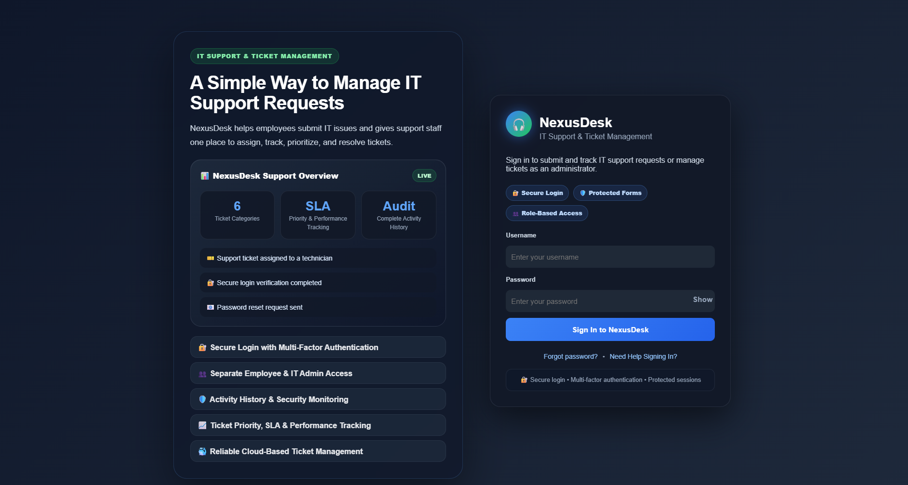
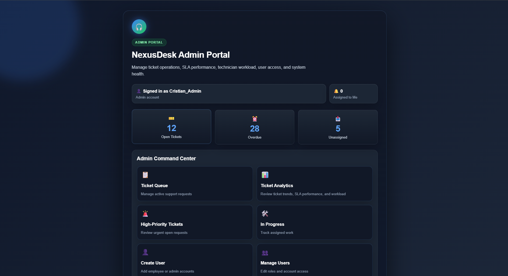
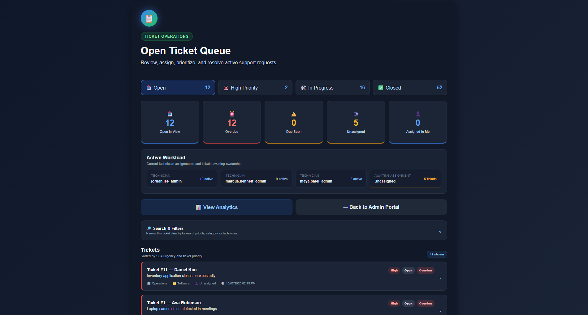
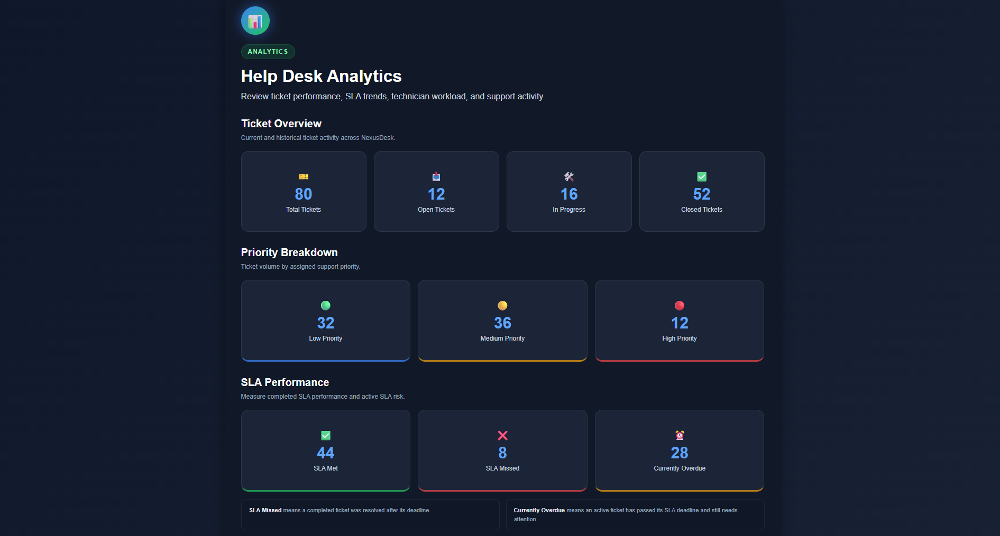
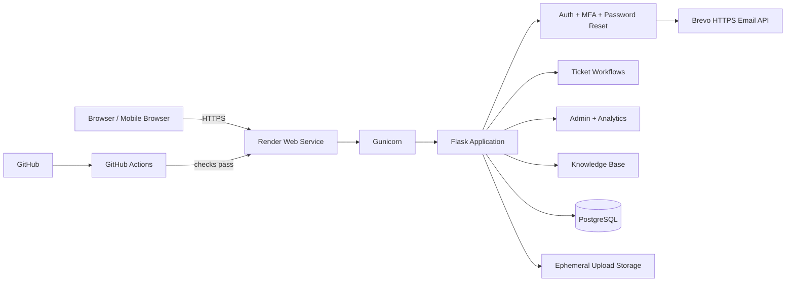

# NexusDesk

**Full-stack IT help desk and ticket management system built with Python, Flask, PostgreSQL, Docker, and GitHub Actions.**

**Live Demo:** [Launch NexusDesk](https://nexusdesk-helpdesk.onrender.com)

## Application Preview



> **Portfolio Demonstration:** NexusDesk is a deployed IT help desk application using a restored portfolio dataset. The system includes employee and administrator workflows, ticket management, SLA tracking, and operational analytics.
>
> **Access Information:** Authentication is required to use the application. Public registration and unrestricted demonstration credentials are not currently provided. Visitors can review the screenshots, architecture, code, and documentation in this repository.
>
> **Hosting Note:** The application runs on Render's free tier and may experience startup delays after inactivity.

## Overview

NexusDesk is a full-stack IT help desk and ticket management system designed to streamline internal IT support operations. Employees can submit and track support requests, while administrators can prioritize tickets, assign technicians, monitor service-level agreements (SLAs), manage user accounts, and review operational activity through integrated dashboards and analytics.

Originally developed as a local Flask application, NexusDesk evolved into a cloud-deployable platform through an iterative software development lifecycle (SDLC). The project incorporates a modular application architecture, security-focused authentication, automated testing, PostgreSQL database integration, Docker containerization, continuous integration (CI), and transactional email functionality.

### Project at a Glance

| Category | Details |
|---|---|
| Project Type | Full-stack IT help desk and ticket management system |
| Development Focus | Systems analysis, software development, security, databases, and IT operations |
| Backend | Python, Flask, Gunicorn |
| Frontend | HTML, CSS, JavaScript, Jinja2 |
| Database | PostgreSQL |
| Infrastructure | Docker, Docker Compose, Render |
| Authentication | Role-based access control, email MFA, password recovery, verified email changes |
| Automated Testing | pytest, branch coverage, PostgreSQL integration testing |
| Continuous Integration | GitHub Actions |
| Portfolio Dataset | 14 users, 80 tickets |
| Current Status | Deployed portfolio application |

### Technical Documentation

For readers interested in the implementation details:

- [System Architecture](docs/ARCHITECTURE.md) — Application components, service boundaries, and deployment design
- [Security Documentation](SECURITY.md) — Authentication, authorization, and application security controls
- [Portfolio Case Study](docs/PORTFOLIO_CASE_STUDY.md) — Engineering decisions, development challenges, and implementation outcomes
- [Changelog](CHANGELOG.md) — Release milestones and subsequent improvements
- [CI Workflows](.github/workflows/) — Automated testing, Docker validation, and PostgreSQL integration

## Application Screenshots

The following screenshots provide an overview of NexusDesk's administrator interface, ticket workflows, and operational reporting.

### Administrator Portal



Administrator interface for managing IT support operations, account administration, and ticket activity.

### Ticket Management



Ticket management interface supporting priority classification, status tracking, technician assignment, and business-hour SLA monitoring.

### Operational Analytics



Operational reporting dashboard showing ticket activity and service-management performance indicators.

## Core Features

### Authentication & security

- Secure password hashing using Werkzeug and role-based access control (RBAC) for employee and administrator accounts
- Email-based multi-factor authentication (MFA) with expiring verification codes, resend support, and a 30-minute trusted-browser window
- Secure account recovery using one-time, expiring password-reset tokens and case-insensitive email lookup
- Account lockout and authentication rate limiting to mitigate repeated unauthorized login attempts
- Cross-site request forgery (CSRF) protection and secure session cookie configuration
- Production security headers, including HSTS, Content Security Policy (CSP), anti-framing, and MIME-sniffing protection
- Audit logging to support accountability, security monitoring, and investigation of account activity
- Verified account email changes using expiring, one-time confirmation tokens, preventing an account's email address from being updated until the proposed address is verified

### Ticket management

- End-to-end ticket lifecycle management, from employee submission and technician assignment through resolution and closure
- Ticket categorization and prioritization using High, Medium, and Low severity levels
- Status tracking across Open, In Progress, and Closed workflows
- Business-hour service-level agreement (SLA) tracking with priority-based deadlines: High (4 business hours), Medium (1 business day), and Low (3 business days).
- Search and filtering capabilities to locate and manage support requests efficiently
- Ticket notes, file attachment workflows, and resolution tracking to support documentation and troubleshooting
- Administrative ticket management with technician assignment and workload visibility

### User and support operations

- Role-based employee and administrator portals with dedicated workflows and access permissions
- Administrative user management, including account creation, modification, deletion, and role assignment
- Department and user profile management to support organizational structure and account administration
- Administrator-initiated support requests and centralized oversight of IT service operations
- Integrated knowledge base with article views, employee feedback, and administrator feedback review
- Branded transactional email notifications supporting account security and application communications
- Operational dashboards and analytics for monitoring ticket volumes, priorities, SLA performance, and technician workloads

### Portfolio demonstration data

NexusDesk uses a portfolio dataset to demonstrate realistic IT support workflows, ticket management, administrative operations, and reporting.

The restored deployment contains:

- 14 user accounts
- 80 support tickets
- 156 ticket notes
- 73 audit log records
- 173 login event records
- 4 administrator accounts

These figures represent the restored portfolio database verified in November 2026, rather than the output of the optional synthetic data generator.

NexusDesk also includes a separate deterministic demonstration-data generator for development and controlled testing. This generator can populate an environment with fictional accounts, support tickets, and related activity records.

**Data Protection:** Automatic demonstration-data seeding is disabled in the current Render deployment (`SEED_DEMO_DATA=false`) to prevent generated records from being added to the restored database.

The public deployment is intended for portfolio demonstration, not storage or processing of actual customer or business information.

## Architecture



The architecture separates application routing, authentication, ticket workflows, administrative functionality, and knowledge management while using PostgreSQL for persistent data storage. Docker supports reproducible development environments, and GitHub Actions automates testing and build validation.

The diagram represents the current Render deployment architecture. Live availability remains subject to the limitations of the free hosting environment.

For a detailed breakdown of application components, service interactions, and deployment considerations, see [`docs/ARCHITECTURE.md`](docs/ARCHITECTURE.md).

## Technology Stack

| Layer | Technology |
|---|---|
| Backend | Python 3.12, Flask |
| Application Server | Gunicorn |
| Database | PostgreSQL |
| Frontend | HTML, CSS, Jinja2 |
| Development Environment | Docker, Docker Compose |
| Authentication & Security | Werkzeug, Flask-WTF, MFA, CSRF protection, rate limiting |
| Email Integration | Brevo Transactional Email API, SMTP fallback |
| Testing | pytest, coverage |
| Continuous Integration | GitHub Actions |
| Cloud Deployment Configuration | Render |
| Version Control | Git, GitHub |

## Repository Structure

```text
nexusdesk-helpdesk/
├── app.py                 # Flask application entry point
├── routes/                # Request handling and application endpoints
├── services/              # Business logic and application services
├── database/              # Database access and configuration
├── migrations/            # Database migration scripts
├── templates/             # Jinja2 HTML templates
├── static/                # CSS, JavaScript, and other static assets
├── scripts/               # Maintenance and utility scripts
├── tests/                 # Automated tests
├── docs/                  # Technical documentation and screenshots
│   └── nexusdesk/         # Application screenshots
├── deployment/            # Deployment configuration and utilities
├── .github/workflows/     # GitHub Actions CI workflows
├── Dockerfile             # Container build instructions
├── docker-compose.yml     # Local multi-container environment
├── render.yaml            # Render deployment configuration
└── README.md              # Project overview and documentation
```

NexusDesk follows a modular Flask architecture that separates request handling, business logic, database operations, and presentation components. This organization improves code maintainability, simplifies testing, and makes individual application features easier to understand and extend.

## Local Development

NexusDesk supports local development using Docker Compose to run the Flask application alongside PostgreSQL.

### Requirements

- Docker Desktop with Docker Compose
- Git
- A local environment configuration file

### 1. Clone the Repository

```bash
git clone https://github.com/Chrisramos2101/nexusdesk-helpdesk.git
cd nexusdesk-helpdesk
```

### 2. Configure Local Environment Variables

Create a `.env` file in the project root using `.env.production.example` as a reference.
The application requires configuration for session security, database connectivity, and optional email integration.

For local development, set `FLASK_ENV=development` and provide a unique `SECRET_KEY`.

Docker Compose automatically configures the application to connect to the PostgreSQL container using the `DATABASE_URL` value defined in `docker-compose.yml`.

Transactional email functionality requires separately configured email-provider credentials. Never use real production secrets in public examples or commits.

**Important:** The `.env` file is local configuration and must not be committed to GitHub.

### 3. Build and Start the Application

```bash
docker compose up --build
```

Docker Compose starts PostgreSQL, waits for its health check, and then starts the NexusDesk application.

### 4. Open NexusDesk

Once both containers are running, open:

http://localhost:5000

### 5. Stop the Application

```bash
docker compose down
```

This stops the containers while preserving the local PostgreSQL data volume.

**Data Safety:** Avoid `docker compose down -v` unless you intentionally want to delete the associated PostgreSQL volume and its stored data.

### Additional Configuration

Refer to `.env.production.example`, `docker-compose.yml`, and `docs/ARCHITECTURE.md` for further configuration and architecture information.

Administrator bootstrap settings and optional demonstration-data generation should be configured only in controlled local environments.

## Environment Configuration

NexusDesk uses environment variables to manage application configuration, database connectivity, and external service credentials.

The repository includes `.env.production.example` as a reference for supported configuration settings.

Configuration values include:

- `SECRET_KEY` — Flask session security
- `DATABASE_URL` — PostgreSQL database connection
- Brevo API credentials — Transactional email integration
- Bootstrap credentials — Initial account configuration

**Security:** Real passwords, API keys, database credentials, and other secrets must never be committed to GitHub. Sensitive configuration values should be provided through local environment variables or the deployment platform's secure environment settings.

## Testing & Continuous Integration

NexusDesk uses automated testing and continuous integration to validate application behavior, security controls, database operations, and deployment readiness.

### Automated Test Suite

Run the complete Python test suite:

```bash
python -m pytest -q
```

For statement and branch coverage:

```bash
python -m pytest \
  --cov=app \
  --cov=database \
  --cov=routes \
  --cov=services \
  --cov-branch \
  --cov-report=term-missing
```

The November 2026 Phase 1 regression run completed with all tests passing and 89% combined statement and branch coverage.

### PostgreSQL Integration Testing

A dedicated GitHub Actions job runs against PostgreSQL 16 to verify database compatibility and relational integrity.

The integration workflow includes:

- PostgreSQL test database initialization
- Application schema creation
- PostgreSQL smoke testing
- Transaction and integrity validation

These tests run against an isolated CI database rather than the live Render production database.

### Source Validation

Validate Python source compilation:

```bash
python -m compileall -q app.py database routes services
```

### Docker Build Validation

Validate the application container build:

```bash
docker build -t nexusdesk .
```

### Continuous Integration

GitHub Actions automatically runs on pushes and pull requests targeting the configured branches.

The CI pipeline includes two jobs:

1. **Test and Build:** Python source validation, automated pytest coverage, and Docker image build validation.
2. **PostgreSQL Integration:** PostgreSQL schema initialization, smoke tests, and transaction/integrity testing.

Commit `92a57fc`, which introduced verified email-change functionality, successfully passed both CI jobs.

These checks help identify regressions and integration problems before changes are deployed to Render.

**CI Configuration:** [View GitHub Actions Workflows](.github/workflows/)

## Cloud Deployment & Portfolio Environment

NexusDesk includes configuration for deploying the application to Render using Docker and PostgreSQL.

### Deployment Architecture

The configured deployment environment includes:

- **Render Web Service:** Docker-based Flask application
- **Gunicorn:** Python WSGI application server
- **PostgreSQL:** Relational database storage
- **HTTPS/TLS:** Secure application traffic
- **Brevo API:** Transactional email integration
- **GitHub Actions:** Automated testing and build validation
- **Health Monitoring:** `/healthz` application and database health endpoint

### Deployment Status

NexusDesk is deployed on Render as a containerized Flask application backed by PostgreSQL.

**Live Application:** [Launch NexusDesk](https://nexusdesk-helpdesk.onrender.com)

The deployment includes Gunicorn, HTTPS, PostgreSQL integration, health monitoring, and automated CI validation through GitHub Actions.

The application was successfully restored and redeployed in November 2026, preserving the original portfolio dataset and administrator access.

**Access:** Authentication is required to access employee and administrator workflows. Public self-registration and unrestricted demo credentials are not provided.

**Hosting Note:** The application uses Render's free-tier infrastructure, so initial requests may experience startup delays after periods of inactivity. Availability may vary with hosting limitations.

### Health Check

NexusDesk includes a `/healthz` endpoint designed to report application and database connectivity.

Example healthy response:

```json
{
  "application": "NexusDesk",
  "database": "postgresql",
  "status": "healthy"
}
```

The example illustrates the expected response when the application and database are operating correctly.

## Security Design

NexusDesk incorporates a defense-in-depth security approach to protect user accounts, enforce access permissions, and reduce common web application risks.

The security architecture combines password hashing, role-based access control, email-based multi-factor authentication, account lockout, rate limiting, CSRF protection, secure session configuration, restrictive HTTP security headers, and audit logging.

Account recovery uses expiring, one-time password-reset tokens. Account email changes follow a verification workflow in which the proposed email address must be confirmed before the stored address is updated.

Security-sensitive functionality is covered by automated regression tests, including authentication, authorization, session management, account recovery, and email-change verification.

**Validation Note:** The email-change implementation passed automated testing and was deployed in November 2026. End-to-end transactional email delivery for this specific workflow has not yet been independently confirmed in the live environment.

For implementation details and security considerations, see [SECURITY.md](SECURITY.md).

## Demo Environment Limitations

NexusDesk is a portfolio demonstration project rather than a commercially deployed IT service management platform.

The configured demonstration environment has the following limitations:

- Free-tier hosting may introduce startup delays and resource constraints.
- Uploaded files stored on ephemeral container storage may be lost during restarts or redeployments.
- The application uses synthetic demonstration data rather than real employee or customer records.
- Demo accounts are intended for controlled testing, not unrestricted public access.
- The application is not intended to process sensitive production information.

These limitations reflect the project's demonstration scope and infrastructure choices. Current deployment availability is documented in the Cloud Deployment & Portfolio Environment section above.

## Engineering Highlights

NexusDesk demonstrates the design, development, testing, and deployment of a full-stack application built around real-world IT service management requirements.

The project emphasizes business workflow analysis, database integrity, application security, maintainable architecture, and deployment reliability.

### Key Engineering Contributions

- **Systems Analysis & Workflow Design:** Translated IT support processes into employee and administrator workflows for ticket submission, prioritization, assignment, escalation monitoring, and resolution.

- **Database Engineering:** Migrated from SQLite-oriented development to PostgreSQL, resolving SQL compatibility and referential-integrity issues while preserving application functionality.

- **Application Architecture:** Organized Flask routes, service modules, database utilities, and Jinja2 templates to improve separation of responsibilities, testability, and maintainability.

- **Security Engineering:** Implemented role-based authorization, password hashing, email MFA, account lockout, rate limiting, CSRF protection, secure session handling, account recovery, and verified email-change functionality.

- **Business-Hour SLA Management:** Built priority-based SLA monitoring using defined support-hour rules and deadlines of 4 business hours for High, 1 business day for Medium, and 3 business days for Low priority tickets.

- **Automated Testing & CI/CD:** Developed a pytest regression suite and GitHub Actions pipeline with Python validation, Docker build checks, and PostgreSQL integration testing.

- **Cloud Deployment & Recovery:** Deployed the application using Docker, Gunicorn, PostgreSQL, and Render; validated restoration of the original portfolio dataset and preserved existing user and ticket records.

- **Operational Analytics:** Implemented reporting interfaces to support visibility into support requests, ticket priorities, SLA performance, and technician workloads.

### Technical Outcomes

- Restored and verified 14 user accounts and 80 support tickets
- Achieved 89% combined statement and branch coverage in the November 2026 regression run
- Successfully completed GitHub Actions test/build and PostgreSQL integration checks
- Deployed a working cloud-hosted application with secure administrator authentication

These outcomes reflect demonstrated development and validation work rather than claims of commercial-scale production usage.

For detailed technical decisions, implementation challenges, and lessons learned, see the [NexusDesk Portfolio Case Study](docs/PORTFOLIO_CASE_STUDY.md).

## Release & Development History

**Latest tagged release:** v1.1.0 — October 8, 2026

**Latest security enhancement:** Verified account email changes — November 11, 2026

NexusDesk uses versioned releases and Git history to document improvements in functionality, security, testing, and deployment.

Version 1.1.0 introduced improvements to business-hour SLA tracking, multi-factor authentication, administrative workflows, operational analytics, and user experience.

Subsequent development expanded automated regression coverage, strengthened authentication and account-management workflows, and introduced verified email-change functionality.

The November 2026 security enhancement is available on the `main` branch as commit [`92a57fc`](https://github.com/Chrisramos2101/nexusdesk-helpdesk/commit/92a57fc). It has not yet been assigned a new version tag.

For historical milestones and changes, see the [Changelog](CHANGELOG.md).

## Author

**Cristian Ramos**  
B.S. Management Information Systems | DePaul University  
Expected Graduation: June 2027

NexusDesk is a portfolio project demonstrating practical experience with full-stack application development, systems analysis, relational databases, security-focused design, automated testing, and IT service operations.

**Connect:** [LinkedIn](https://www.linkedin.com/in/cristian-ramos-85a98a272/) | [GitHub](https://github.com/Chrisramos2101)
