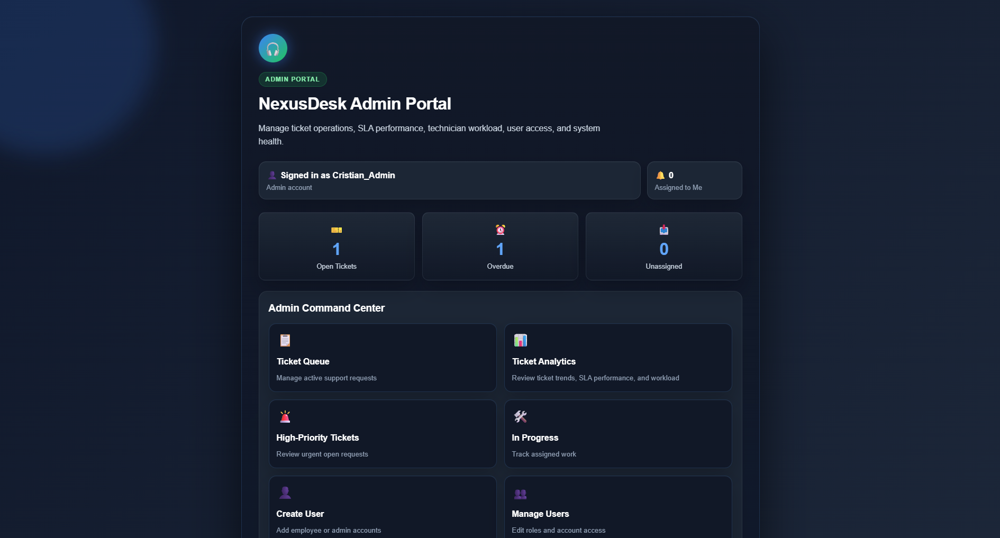
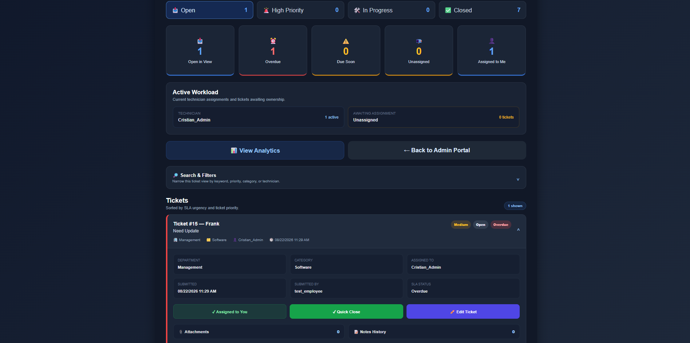
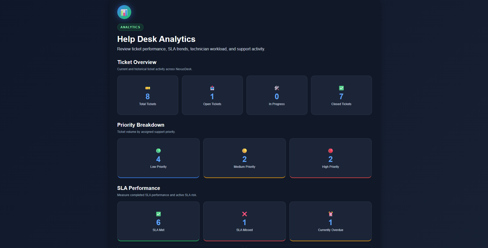
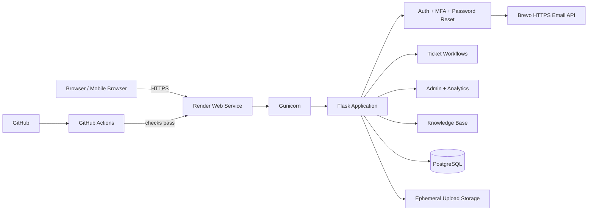

# NexusDesk

**Full-stack IT help desk and ticket management system built with Python, Flask, PostgreSQL, Docker, and GitHub Actions.**

## Application Preview


> NexusDesk is a portfolio demonstration project designed to use synthetic data. It is not intended to store real business or customer information.

## Overview

NexusDesk is a full-stack IT help desk and ticket management system designed to streamline internal IT support operations. Employees can submit and track support requests, while administrators can prioritize tickets, assign technicians, monitor service-level agreements (SLAs), manage user accounts, and review operational activity through integrated dashboards and analytics.

Originally developed as a local Flask application, NexusDesk evolved into a cloud-deployable platform through an iterative software development lifecycle (SDLC). The project incorporates a modular application architecture, security-focused authentication, automated testing, PostgreSQL database integration, Docker containerization, continuous integration (CI), and transactional email functionality.


## Application Screenshots

### Administrator Portal



### Ticket Management



### Operational Analytics




## Core Features

### Authentication & security

- Secure password hashing using Werkzeug and role-based access control (RBAC) for employee and administrator accounts
- Email-based multi-factor authentication (MFA) with expiring verification codes, resend support, and a 30-minute trusted-browser window
- Secure account recovery using one-time, expiring password-reset tokens and case-insensitive email lookup
- Account lockout and authentication rate limiting to mitigate repeated unauthorized login attempts
- Cross-site request forgery (CSRF) protection and secure session cookie configuration
- Production security headers, including HSTS, Content Security Policy (CSP), anti-framing, and MIME-sniffing protection
- Audit logging to support accountability, security monitoring, and investigation of account activity

### Ticket management

- End-to-end ticket lifecycle management, from employee submission and technician assignment through resolution and closure
- Ticket categorization and prioritization using High, Medium, and Low severity levels
- Status tracking across Open, In Progress, and Closed workflows
- Business-hour service-level agreement (SLA) tracking with priority-based deadlines: High (4 business hours), Medium (1 business day), and Low (3 business days).
- Search and filtering capabilities to locate and manage support requests efficiently
- Ticket notes, file attachment workflows, and resolution tracking to support documentation and troubleshooting
- Administrative ticket management with technician assignment and workload visibility

### User and support operations

- Role-based employee and administrator portals with dedicated workflows and access permissions
- Administrative user management, including account creation, modification, deletion, and role assignment
- Department and user profile management to support organizational structure and account administration
- Administrator-initiated support requests and centralized oversight of IT service operations
- Integrated knowledge base with article views, employee feedback, and administrator feedback review
- Branded transactional email notifications supporting account security and application communications
- Operational dashboards and analytics for monitoring ticket volumes, priorities, SLA performance, and technician workloads

### Portfolio demonstration data

NexusDesk includes a deterministic, synthetic dataset designed to demonstrate realistic IT support workflows without exposing actual employee, customer, or business information.

The demonstration data generator is configured to create:

- 14 fictional demo users
- 72 synthetic support tickets
- 174 ticket notes
- 224 login events
- 174 synthetic audit events plus a seed marker
- 120 knowledge-base views
- 28 knowledge-base feedback records

Synthetic users use the `demo_` username prefix and `example.com` email addresses. The seeding process is designed to be idempotent, preventing duplicate demonstration records when executed repeatedly.

The dataset is intended solely for development, testing, and portfolio demonstration purposes.

## Architecture



The architecture separates application routing, authentication, ticket workflows, administrative functionality, and knowledge management while using PostgreSQL for persistent data storage. Docker supports reproducible development environments, and GitHub Actions automates testing and build validation.

The diagram illustrates the application's configured cloud deployment architecture. Public deployment availability is not currently guaranteed.

For a detailed breakdown of application components, service interactions, and deployment considerations, see [`docs/ARCHITECTURE.md`](docs/ARCHITECTURE.md).

## Technology Stack

| Layer | Technology |
|---|---|
| Backend | Python 3.12, Flask |
| Application Server | Gunicorn |
| Database | PostgreSQL |
| Frontend | HTML, CSS, Jinja2 |
| Development Environment | Docker, Docker Compose |
| Authentication & Security | Werkzeug, Flask-WTF, MFA, CSRF protection, rate limiting |
| Email Integration | Brevo Transactional Email API, SMTP fallback |
| Testing | pytest, coverage |
| Continuous Integration | GitHub Actions |
| Cloud Deployment Configuration | Render |
| Version Control | Git, GitHub |

## Repository Structure

```text
nexusdesk-helpdesk/
├── app.py                 # Flask application entry point
├── routes/                # Request handling and application endpoints
├── services/              # Business logic and application services
├── database/              # Database access and configuration
├── migrations/            # Database migration scripts
├── templates/             # Jinja2 HTML templates
├── static/                # CSS, JavaScript, and other static assets
├── scripts/               # Maintenance and utility scripts
├── tests/                 # Automated tests
├── docs/                  # Technical documentation and screenshots
│   └── nexusdesk/         # Application screenshots
├── deployment/            # Deployment configuration and utilities
├── .github/workflows/     # GitHub Actions CI workflows
├── Dockerfile             # Container build instructions
├── docker-compose.yml     # Local multi-container environment
├── render.yaml            # Render deployment configuration
└── README.md              # Project overview and documentation
```

NexusDesk follows a modular Flask architecture that separates request handling, business logic, database operations, and presentation components. This organization improves code maintainability, simplifies testing, and makes individual application features easier to understand and extend.

## Local Development

NexusDesk supports local development using Docker Compose to run the Flask application with a PostgreSQL database.

### Requirements

- Docker Desktop
- Git

Clone the repository:

```bash
git clone https://github.com/Chrisramos2101/nexusdesk-helpdesk.git
cd nexusdesk-helpdesk
```

Start the local PostgreSQL-backed application:

```bash
docker compose up --build
```

Once the services are ready, open:

```text
http://localhost:5000
```

### Stopping the Application

Stop the containers:

```bash
docker compose down
```

**Note:** Avoid using `docker compose down -v` unless you intentionally want to delete the local PostgreSQL volume and its stored data.

## Environment Configuration

NexusDesk uses environment variables to manage application configuration, database connectivity, and external service credentials.

The repository includes `.env.production.example` as a reference for supported configuration settings.

Configuration values include:

- `SECRET_KEY` — Flask session security
- `DATABASE_URL` — PostgreSQL database connection
- Brevo API credentials — Transactional email integration
- Bootstrap credentials — Initial account configuration

**Security:** Real passwords, API keys, database credentials, and other secrets must never be committed to GitHub. Sensitive configuration values should be provided through local environment variables or the deployment platform's secure environment settings.

## Testing

NexusDesk includes automated testing and validation workflows to support application reliability, code quality, and deployment readiness.

### Automated Tests

Run the complete Python test suite:

```bash
python -m pytest -q
```

### Source Validation

Check Python files for syntax and compilation errors:

```bash
python -m compileall -q .
```

### Docker Configuration Validation

Validate the Docker Compose configuration:

```bash
docker compose config --quiet
```

### Continuous Integration

GitHub Actions is configured to run automated checks on pushes and pull requests, including:

- Python source compilation
- pytest execution and coverage reporting
- Docker image build validation

These checks help detect regressions and configuration problems before deployment.

See the [GitHub Actions workflows](.github/workflows/) for the CI configuration.

## Cloud Deployment & Portfolio Environment

NexusDesk includes configuration for deploying the application to Render using Docker and PostgreSQL.

### Deployment Architecture

The configured deployment environment includes:

- **Render Web Service:** Docker-based Flask application
- **Gunicorn:** Python WSGI application server
- **PostgreSQL:** Relational database storage
- **HTTPS/TLS:** Secure application traffic
- **Brevo API:** Transactional email integration
- **GitHub Actions:** Automated testing and build validation
- **Health Monitoring:** `/healthz` application and database health endpoint

### Deployment Status

The application was previously deployed as a portfolio demonstration environment. The public Render service is currently unavailable, so live access is not guaranteed.

The repository retains its deployment configuration, containerization files, and automated testing workflows for technical review.

### Health Check

NexusDesk includes a `/healthz` endpoint designed to report application and database connectivity.

Example healthy response:

```json
{
  "application": "NexusDesk",
  "database": "postgresql",
  "status": "healthy"
}
```

The example illustrates the expected response when the application and database are operating correctly.

## Security Design

NexusDesk uses defense-in-depth controls rather than relying on a single authentication check.

Key controls include secure cookies, CSRF protection, role authorization decorators, password hashing, rate limiting, failed-login lockout, one-time reset tokens, expiring MFA challenges, audit events, content security policy, HSTS, anti-frame protection, and restrictive browser permission headers.

See [`SECURITY.md`](SECURITY.md) for the security model and responsible-use notes.

## Cloud Demo Limitations

The public deployment intentionally uses free portfolio infrastructure.

- The service may need time to wake after inactivity.
- Free-tier upload storage is ephemeral.
- The cloud database is for synthetic/demo content rather than durable business records.
- Demo users are synthetic and are not intended as public login credentials.
- The public system should never be used for sensitive production data.

These are hosting-tier constraints, not hidden application assumptions.

## Engineering Highlights

The project demonstrates:

- migration from SQLite-oriented development to PostgreSQL
- transactional data migration and foreign-key reconciliation
- Dockerized application/database workflows
- CI automation
- production configuration validation
- cloud health monitoring
- secure reverse-proxy handling
- transactional email integration
- deterministic/idempotent demo data generation
- automated regression and public acceptance gates

A portfolio-oriented engineering summary is available in [`docs/PORTFOLIO_CASE_STUDY.md`](docs/PORTFOLIO_CASE_STUDY.md).

## Release

Current release: **v1.1.0**

See:

- [`CHANGELOG.md`](CHANGELOG.md)
- [`docs/RELEASE_CHECKLIST.md`](docs/RELEASE_CHECKLIST.md)

## Author

**Cristian Ramos**

NexusDesk was developed as a software engineering, cloud deployment, security, and IT operations portfolio project.
